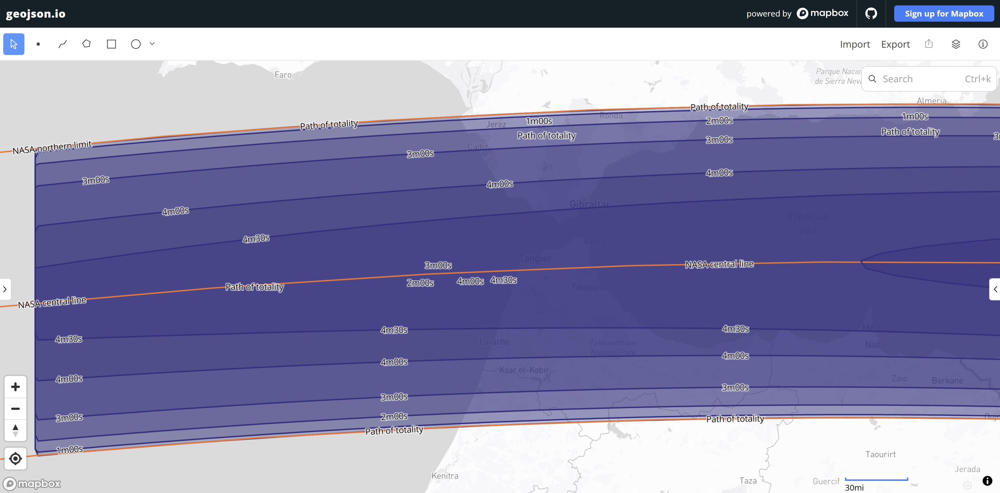
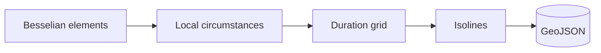

# Chasing totality

A personal tool for picking a spot to watch a total solar eclipse. You explore a map with the path of totality on it, click a location, and get what you need to decide: how long totality lasts there, whether the sky is usually clear, how to fly there and whether it's safe.

**Current status:** totality duration for any lat/lon and isolines on a map, for 2 August 2027. Weather, flights and safety are planned.

**Stack:** TypeScript + Node 24, Fastify, React + Vite, MapLibre GL JS + OpenFreeMap, Vitest, d3-contour



## Quick Overview



**Key Features:**

- ✅ Totality duration for any lat/lon, from NASA's Besselian elements
- ✅ Isolines every 30 s, from the path's edge up to 6 minutes, as GeoJSON
- ✅ Tested against NASA's path table and NASA's JSEX calculator

How it works, what was measured and what's left out: [spike #4 plan and findings](docs/plans/004-local-totality-duration-plan.md).

## Quick Start

### System requirements

- NVM (Node Version Management)
- Node.js >= 24
- PNPM 10.18.2 (via corepack)

### Development

```bash
nvm use
pnpm install

pnpm test        # run the tests
pnpm typecheck   # type-check without emitting
pnpm dev         # start the API with reload on port 3000
pnpm build       # compile src/ to dist/
pnpm start       # run the compiled API
pnpm spike:grid  # write the isolines to out/
```

The API settings and their defaults are in [`.env.example`](.env.example); copy it to `.env` to change them. Endpoints:

- `GET /health`: `{"status":"ok"}`
- `GET /eclipses`: dates with data, e.g. `["2027-08-02"]`
- `GET /eclipses/:date/isolines`: GeoJSON isolines; 404 if there's no data, 422 for an invalid date

`pnpm spike:grid` writes two files:

- `out/2027-durations.geojson`: the isolines.
- `out/2027-nasa-path.geojson`: NASA's limits and central line, to compare against.

Drop both into [geojson.io](https://geojson.io) to see them on a map. To update the data the API serves, copy `out/2027-durations.geojson` to `data/isolines/2027-08-02.geojson`.

### Frontend

The React app lives in `web/`, a pnpm workspace package. It calls `/api/*` on its own origin and the Vite dev server forwards those requests to the API (prefix removed), so run both:

```bash
pnpm dev                         # API on port 3000
pnpm --filter web dev            # frontend on http://localhost:5173
pnpm --filter web test           # frontend tests
pnpm --filter web typecheck
pnpm --filter web build          # static files in web/dist
```

The page shows the API status from `GET /api/health` and a map: an [OpenFreeMap](https://openfreemap.org) base map drawn by [MapLibre GL JS](https://maplibre.org), with the 2027-08-02 isolines from `GET /api/eclipses/2027-08-02/isolines` on top. The tiles come straight from OpenFreeMap: no key, no proxy. The proxy target is `API_PROXY_TARGET` (default `http://localhost:3000`).

`pnpm spike:fixtures` regenerates `test/fixtures/jsex-2027.json` from NASA's JSEX. Only needed if the test points or the elements change.

### Docker

`compose.yaml` is the production stack: the compiled API and the built frontend served by nginx. `compose.dev.yaml` is an override that turns the same two services into development mode, with your source mounted and reload on.

|          | Prod                          | Dev                                                             |
| -------- | ----------------------------- | --------------------------------------------------------------- |
| Command  | `docker compose up --build`   | `docker compose -f compose.yaml -f compose.dev.yaml up --build` |
| API      | http://localhost:3000/health  | http://localhost:3000/health (`pnpm dev`)                       |
| Frontend | http://localhost:8080 (nginx) | http://localhost:5173 (Vite)                                    |

In both, the frontend reaches the API through `/api`. In dev, after adding a dependency, add `-V` to `up --build`: `node_modules` lives in a volume that otherwise keeps the old packages.

```bash
# Tests and scripts run in the dev container; out/ shows up on the host
docker compose -f compose.yaml -f compose.dev.yaml run --rm api pnpm test
docker compose -f compose.yaml -f compose.dev.yaml run --rm api pnpm spike:grid
```

The frontend's nginx forwards `/api` to a host named `api`, so it only starts where the `api` service exists (as in compose).

## Project Structure

```
src/
└── engine/                # Everything that computes; a frontend/backend would only consume it
    ├── eclipse/           # Totality duration at one place
    │   ├── elements/      # Besselian elements per eclipse
    │   ├── besselian.ts   # Evaluates the elements at a given time
    │   ├── observer.ts    # Observer's position relative to the Earth's centre
    │   └── localCircumstances.ts  # Eclipse type, contact times and duration
    └── isolines/
        ├── grid.ts        # Engine values on a lat/lon grid
        └── contours.ts    # Grid to GeoJSON isolines
└── server/                # Fastify API
    ├── app.ts             # Builds the app: logger, data dir, /health
    ├── routes/eclipses.ts # /eclipses and /eclipses/:date/isolines
    └── main.ts            # Reads the env, listens, shuts down cleanly

web/                   # React + Vite frontend (own package, tests and Dockerfile)
├── src/               # App, the API status and the map with its isolines layers
└── test/              # Vitest + Testing Library tests, mirroring src/

data/isolines/         # Pre-generated isolines the API serves, one file per eclipse
scripts/               # spike:grid, spike:fixtures
test/                  # Vitest tests and fixtures (NASA path table, JSEX)
docs/plans/            # Plans, deviations and findings
```

The repo is a [pnpm workspace](https://pnpm.io/workspaces): the root package (engine and API) and `web/` each have their own `package.json` and dependencies, and share one lockfile. Run a script in `web/` from the root with `pnpm --filter web <script>`.
