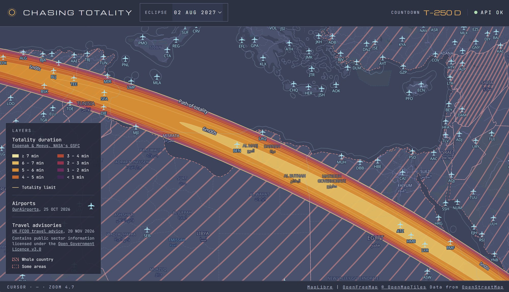
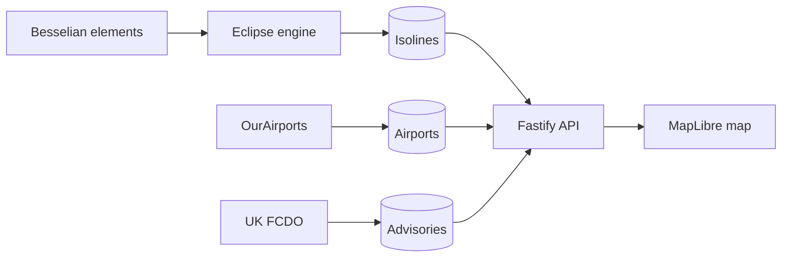

# Chasing totality

A personal tool for picking a spot to watch a total solar eclipse. You explore a map with the path of totality on it, click a location, and get what you need to decide: how long totality lasts there, how to fly there, whether it's safe and the chance of clear skies.

**Current status:** totality duration and isolines on a globe for total eclipses from 1901 to 2100 (four loaded so far), with travel advisories and airports for upcoming ones. Weather is planned.

**Stack:** TypeScript + Node 24, Fastify, React + Vite, MapLibre GL JS + OpenFreeMap, Vitest, d3-contour, Docker.



## Quick Overview



How the engine computes the isolines: [src/engine/README.md](src/engine/README.md).

**Features:**

- Path of totality and 30 s duration isolines on a globe, for eclipses from 1901 to 2100
- Pick an eclipse, with a countdown to the next one
- Airports and UK travel advisories for upcoming eclipses
- Engine checked against NASA's path table for every eclipse, and NASA's JSEX for 2027

## Quick Start

### System requirements

- Node.js >= 24
- NVM (Node Version Manager), optional: reads `.nvmrc`
- pnpm 10.18.2 (via corepack)
- Docker with Compose v2, optional: for the containerised stack

### Run it locally

```
git clone https://github.com/imagobea/chasing-totality.git
cd chasing-totality
```

Then with pnpm, in two terminals:

```
nvm use && corepack enable && pnpm install
pnpm dev              # API
pnpm --dir web dev    # app on http://localhost:5173
```

Or with Docker (same URL):

```
docker compose -f compose.yaml -f compose.dev.yaml up --build
```

`compose.yaml` is the production stack: the compiled API and the built frontend served by nginx. `compose.dev.yaml` is an override that turns the same two services into development mode, with your source mounted and reload on.

In dev, after adding a dependency, add `-V` to `up --build`: `node_modules` lives in a volume that otherwise keeps the old packages.

The API settings and their defaults are in [`.env.example`](.env.example); copy it to `.env` to change them.

## Project Structure

```
src/engine/   # Eclipse maths, no I/O: elements → duration → isolines (see its README)
src/server/   # Fastify API: loads data/ at boot, routes/ serves eclipses, airports, advisories
web/          # React + Vite + MapLibre app, its own package with tests and Dockerfile
data/         # Committed data the API serves, plus NASA's path tables to test against
scripts/      # Data generators: data:isolines, data:airports, data:advisories, fixtures:jsex
tests/        # Vitest: unit/, integration/, helpers/, fixtures/
docs/         # DECISIONS.md (why it's built this way), plans/, design/
```

The repo is a [pnpm workspace](https://pnpm.io/workspaces): the root package (engine and API) and `web/` each have their own `package.json`, and share one lockfile. Run a script in `web/` from the root with `pnpm --dir web <script>`.

## Data

Everything the API serves is committed, so there's nothing to generate before running the app. To refresh a dataset, run its command and commit the result.

| Data       | Source                                                                                                                                     | Command                     | File                           |
| ---------- | ------------------------------------------------------------------------------------------------------------------------------------------ | --------------------------- | ------------------------------ |
| Isolines   | Our engine, from NASA's Besselian elements                                                                                                 | `pnpm data:isolines <date>` | `data/isolines/<date>.geojson` |
| Airports   | [OurAirports](https://ourairports.com/data/) (public domain)                                                                               | `pnpm data:airports`        | `data/airports.geojson`        |
| Advisories | [UK FCDO](https://www.gov.uk/foreign-travel-advice) (OGL v3), on [Natural Earth](https://www.naturalearthdata.com/) shapes (public domain) | `pnpm data:advisories`      | `data/advisories.geojson`      |

The base map is [OpenFreeMap](https://openfreemap.org/) © OpenStreetMap contributors.

### Add an eclipse

In Claude Code, run `/add-eclipse <date>` for any total eclipse from 1901 to 2100. It adds the Besselian elements and NASA's path table, checks them against each other, generates the isolines, and stops for your review before anything is committed. The steps, if you'd rather do it by hand: [.claude/skills/add-eclipse/SKILL.md](.claude/skills/add-eclipse/SKILL.md).

## API

The app calls the API through `/api`; locally it's also on http://localhost:3000. Responses are JSON or GeoJSON.

| Endpoint                                   | Returns                                                                                 |
| ------------------------------------------ | --------------------------------------------------------------------------------------- |
| `GET /health`                              | `{"status":"ok"}`                                                                       |
| `GET /eclipses`                            | The eclipses with data, each with its date and the bbox around its path                 |
| `GET /eclipses/:date/isolines`             | The eclipse's isolines and path of totality; 404 if there's no data, 422 for a bad date |
| `GET /airports?bbox=west,south,east,north` | Airports with their source; the optional bbox keeps those inside it, 422 if invalid     |
| `GET /advisories`                          | Every country or territory's UK travel advisory and shape, with sources                 |
